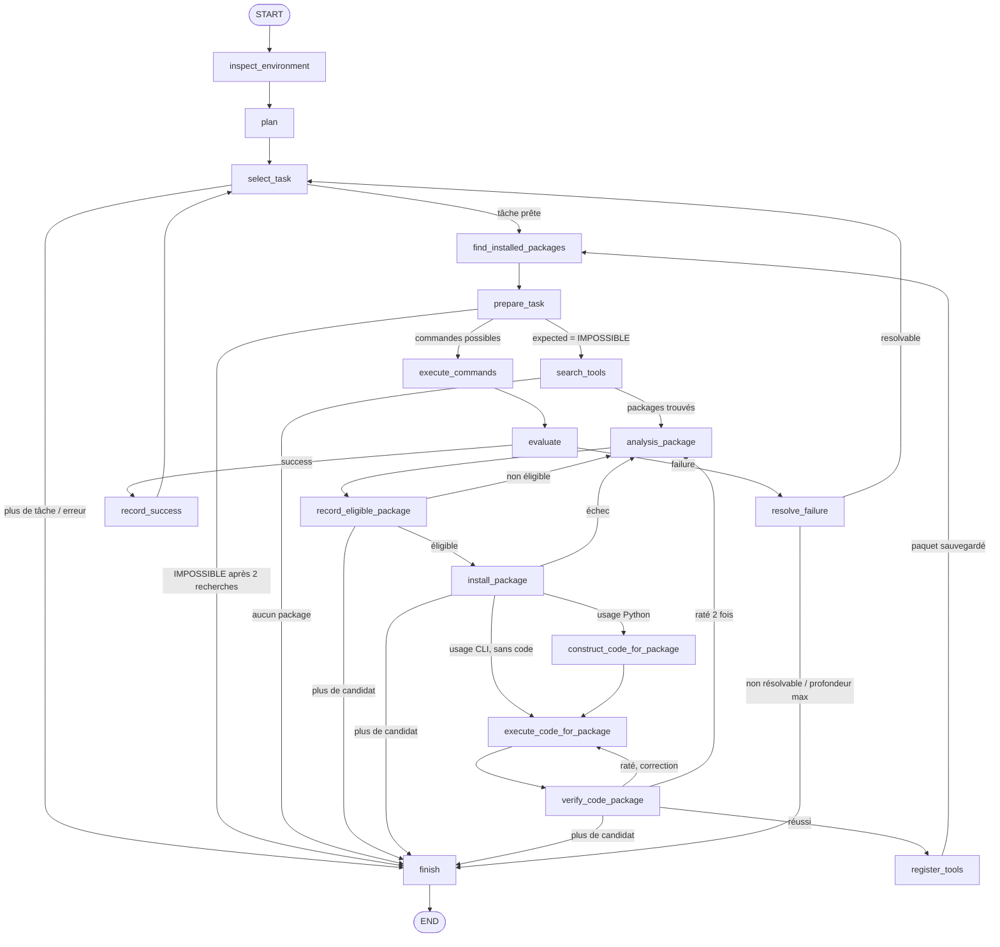

# EV Agent Linux

Agent Linux autonome expérimental basé sur **LangChain**, **LangGraph** et **Ollama**.

> ⚠️ **Projet expérimental.** L'agent peut générer du code et exécuter des commandes Linux. Il ne faut pas l'utiliser sur une machine de production ou contenant des données importantes sans sandbox/VM et contrôles supplémentaires. Pour les tests, utiliser un workspace jetable (`--workspace /chemin/temporaire`).

## Sommaire

- [Objectif du projet](#-objectif-du-projet)
- [Choix Techniques](#choix-techniques)
  - [Harness : un graphe LangGraph explicite plutôt qu'une boucle ReAct](#harness--un-graphe-langgraph-explicite-plutôt-quune-boucle-react)
  - [Modèle local : Ollama + `qwen2.5:3b`, `temperature=0`](#modèle-local--ollama--qwen253b-temperature0)
  - [Sorties structurées Pydantic partout](#sorties-structurées-pydantic-partout)
  - [Prompts dans des fichiers `.txt`](#prompts-dans-des-fichiers-txt)
  - [Exécution : commandes Linux dans un workspace par agent](#exécution--commandes-linux-dans-un-workspace-par-agent)
  - [Persistance : checkpointer SQLite et registre JSON](#persistance--checkpointer-sqlite-et-registre-json)
  - [Recherche d'outils : PyPI via SearXNG, puis pipeline en 5 étapes](#recherche-doutils--pypi-via-searxng-puis-pipeline-en-5-étapes)
  - [RAG de documentation : chunks Markdown + bge-m3 + FAISS](#rag-de-documentation--chunks-markdown--bge-m3--faiss)
  - [Observabilité : logs fichier vidés à chaque ligne + chronométrage](#observabilité--logs-fichier-vidés-à-chaque-ligne--chronométrage)
  - [Évaluation : Phoenix et benchs par brique](#évaluation--phoenix-et-benchs-par-brique)
  - [Configuration : `AgentConfig` dataclass gelée](#configuration--agentconfig-dataclass-gelée)
- [Architecture](#architecture)
  - [Flux détaillé](#flux-détaillé)
  - [Structure du code](#structure-du-code)
- [Installation](#installation)
  - [1. Environnement Python](#1-environnement-python)
  - [2. Ollama](#2-ollama)
  - [3. SearXNG (obligatoire)](#3-searxng-obligatoire)
- [Utilisation](#utilisation)
- [Evaluation](#evaluation)
  - [Bench de la recherche de packages (Phoenix)](#bench-de-la-recherche-de-packages-phoenix)
  - [Bench du RAG de documentation (Phoenix)](#bench-du-rag-de-documentation-phoenix)
  - [Bench étape par étape](#bench-étape-par-étape)
  - [Bench de la sauvegarde des paquets (Phoenix)](#bench-de-la-sauvegarde-des-paquets-phoenix)
- [Logs et suivi des performances](#logs-et-suivi-des-performances)
- [Roadmap](#roadmap)
- [Références](#références)

## 🎯 Objectif du projet

L'objectif architectural est de construire une IA capable de **déterminer elle-même les outils dont elle a besoin, générer ces outils, installer les packages nécessaires, les utiliser, vérifier le résultat et apprendre de ses échecs via une boucle de résolution**.

Cette capacité d'auto-outillage est **la direction cible du projet**.

Un autre objectif est une IA completement locale, il y a donc une contrainte computationnel.

## Choix Techniques

Chaque choix est accompagné de sa justification.

### Harness : un graphe LangGraph explicite plutôt qu'une boucle ReAct

**LangGraph** décrit le workflow sous forme de machine à états : planification, exécution, vérification et résolution d'erreurs.

Un agent ReAct classique (« le LLM choisit un outil, voit le résultat, recommence ») suppose un modèle capable de garder le fil sur de nombreux tours et d'appeler des outils de manière fiable. Avec un modèle local de 3B (`qwen2.5:3b`), ce n'est pas le cas : il se perd, boucle ou s'arrête trop tôt. Le harness retire donc au LLM le **contrôle du flux** et ne lui laisse que des **décisions locales et petites** :

- chaque nœud (`plan`, `prepare_task`, `evaluate`, `resolve_failure`, `analysis_package`…) fait **un seul appel LLM** avec **un prompt dédié** et **un schéma de sortie dédié** ;
- l'enchaînement est décidé par du **code Python déterministe** (`route_after_*`, méthodes statiques testables sans LLM) ;
- le graphe est lisible (Mermaid / `--savegraph`), chaque transition est loguée et chronométrée, ce qui permet de savoir exactement **quel rôle** a échoué ;
- LangGraph apporte l'état typé, les arêtes conditionnelles, les cycles (boucle de résolution) et la persistance (checkpointer).

C'est une architecture **plan-and-execute** avec un **vérificateur séparé** et une **boucle de réparation** :

| Rôle | Pourquoi séparé |
|---|---|
| `plan` (planificateur) | Découper une demande floue en tâches avec entrées/sorties explicites rend chaque étape vérifiable. |
| `prepare_task` (traducteur tâche → commandes) | Le prompt ne voit qu'une tâche à la fois : contexte court, adapté à un petit modèle. |
| `execute_commands` (code, pas de LLM) | L'exécution doit être fidèle : stdout, stderr, code retour et durée sont des faits, pas des opinions. |
| `evaluate` (vérificateur) | Le modèle qui a produit les commandes a tendance à se juger réussi ; un appel séparé, avec un prompt « ne propose rien, juge seulement », limite ce biais. |
| `resolve_failure` (résolveur) | Transforme un échec en nouvelles tâches qui passent par le **même** pipeline (pas de chemin spécial), avec une profondeur maximale (`max_resolution_depth`) pour garantir la terminaison. |
| Branche `search_tools` → `register_tools` | L'auto-outillage est isolé dans un sous-flux : la boucle principale ne change pas quand on ajoute un outil, elle relance simplement `prepare_task`. |

### Modèle local : Ollama + `qwen2.5:3b`, `temperature=0`

**LangChain** fournit l'intégration avec Ollama, les messages et les sorties structurées. Ollama est gratuit, hors ligne, sans clé d'API, et un 3B tourne sur une machine modeste. Qwen 2.5 est l'un des petits modèles les plus fiables en sortie JSON et en code. `temperature=0` vise la reproductibilité (mêmes entrées → mêmes sorties autant que possible), indispensable pour les benchs.

### Sorties structurées Pydantic partout

Chaque appel LLM renvoie un objet Pydantic (`PlanOutput`, `EvaluationOutput`, `PackageInstall`…). `langchain-ollama` utilise par défaut la méthode `json_schema`, c'est-à-dire le **décodage contraint** d'Ollama : le modèle ne peut produire que du JSON conforme au schéma. C'est ce qui rend un 3B utilisable dans un harness (aucune erreur de parsing observée). Les routes lisent des booléens (`success`, `resolvable`, `utility`…) au lieu d'analyser du texte.

### Prompts dans des fichiers `.txt`

Séparer les prompts du code permet de les modifier sans toucher à Python, de les comparer dans les benchs et de changer de répertoire (`--prompts-dir`). Le cache de `PromptLoader` évite de relire le disque.

### Exécution : commandes Linux dans un workspace par agent

Le terminal Linux est l'outil universel : `curl`, `pip`, `apt`, `python3`… donnent accès à un grand nombre de programmes et de packages libres sans écrire un outil LangChain par capacité. Chaque commande a un timeout (`--timeout`), sa sortie est tronquée (`compact`, 16 000 caractères) pour ne pas saturer le contexte du LLM, et elle s'exécute dans `projet_<id>/` pour que les fichiers produits restent au même endroit. `parse_install_command` détecte les installations pour les inscrire au registre.

### Persistance : checkpointer SQLite et registre JSON

Les états sont sauvegardés après chaque nœud par un checkpointer SQLite (`projet_<id>/checkpoints<id>.sqlite`) : on peut reprendre un run long sans tout refaire (`--checkpoint`) et inspecter l'historique. SQLite ne demande aucun service. Le registre `.agent/tools.json` est volontairement un simple fichier lisible : l'agent le reçoit dans `environment` et sait ce qu'il a déjà installé ou généré.

**Sauvegarde des paquets** (`agent/package_registry.py`, `.agent/packages.json`) : un paquet n'y entre **que s'il a été installé puis validé** par la boucle `execute_code_for_package` → `verify_code_package`. La fiche garde tout ce qui est connu : métadonnées PyPI (version, résumé, mots-clés, page d'accueil), commande d'installation qui a marché, analyse d'usage (Python / CLI, clé d'API, payant), extraits de doc du RAG, outil Python généré (copié dans `.agent/tools/`) ou commande CLI validée, sortie du test, et une **description + des capacités rédigées par le LLM** (prompt `package_describer`). Les fiches sont indexées avec bge-m3 (cache `.agent/packages_embeddings.json`, recalculé seulement quand une fiche change). `--reset` vide aussi ce registre.

### Recherche d'outils : PyPI via SearXNG, puis pipeline en 5 étapes

- **PyPI** : Python est déjà présent, `pip` est le gestionnaire le plus simple à automatiser, et l'API JSON de PyPI fournit le README, les versions et la compatibilité Python sans scraping.
- **SearXNG** (moteur de recherche local, via Docker) : sans clé d'API, interrogeable en HTTP ; `site:pypi.org` restreint les résultats aux projets.
- **Plusieurs moteurs combinés** (Startpage, Presearch, Yandex, Seznam, Marginalia) : ils respectent `site:` et se relaient quand l'un est suspendu (voir la section SearXNG).

Chaque étape du pipeline a été **gardée parce qu'elle a été mesurée** (voir les tableaux du bench) :

| Étape | Justification |
|---|---|
| 1. 3 requêtes courtes | Des mots-clés courts ramènent plus de bons résultats. |
| 2. Noms proposés par le LLM | Le modèle *connaît* souvent la bonne bibliothèque (`requests`, `pypdf`, `qrcode`) ; vérifier le nom sur PyPI élimine les hallucinations. Seule, c'est l'étape la plus efficace. |
| 5. Normalisation | Les URLs de version (`/project/x/0.3.4/`) créent des doublons. |
| 4. Filtre métadonnées (sans LLM) | Élimine à coût nul les packages morts, incompatibles ou confidentiels — et protège du *slopsquatting* causé par l'étape 2. |
| 3. Classement LLM | Un seul appel sur nom + résumé, **avant** l'analyse coûteuse (indexation), réordonne une liste où SearXNG classe mal (MRR 0,43 seul). |
| Limite à 3 candidats | Chaque analyse coûte ~20 s ; au-delà de 3 le gain est nul sur le bench. |

### RAG de documentation : chunks Markdown + bge-m3 + FAISS

Le **RAG FAISS + bge-m3** (`agent/rag.py`) indexe la documentation des packages pour retrouver les passages utiles. Le README entier d'un package dépasse le contexte utile d'un 3B ; il ne faut lui montrer que les passages « installation » et « usage ».

- **Découpage par sections Markdown** (titres conservés, blocs de code jamais coupés) : un README est déjà structuré, la section « Installation » est une unité de sens.
- **Multi-niveau** (`rag_multi_level=True`, défaut) : chaque phrase de prose et chaque ligne de code est indexée **en plus** de sa section, et renvoie sa section entière (le score d'une section est le max de ses entrées). Une ligne `pip install x` noyée dans une longue section (yt-dlp, qrcode, icrawler) ressort alors en tête. Mesuré avec `bench/rag_bench.py` (17 packages) : commande d'install présente dans le contexte **81 % → 100 %**, exemple d'usage **94 % → 100 %**, MRR install 0,82 → 0,97 ; contexte ~20 % plus long, indexation ~3× plus lente.
- Testés puis abandonnés (trop lents pour le gain, run complet non terminé) : questions générées par chunk et réponse hypothétique à la requête (HyDE), qui demandent un appel LLM par chunk / par requête.
- **bge-m3** : modèle d'embedding multilingue, servi par le même Ollama (aucune dépendance supplémentaire).
- **FAISS `IndexFlatIP`** sur vecteurs normalisés (= cosinus) : recherche exacte, aucun entraînement, instantanée pour quelques centaines de chunks.
- **Cache par `nom-version`** (`projet_<id>/.rag/<nom>-<version>-v<INDEX_FORMAT>[-ml]/`, `INDEX_FORMAT` à incrémenter quand le document indexé change) : la doc d'une version ne change pas.
- **top-1 pour l'installation** (`rag_install_k`), **top-3 par requête d'usage** (`rag_usage_k`) : mesuré, plus le contexte est long, moins le 3B renvoie la commande (voir le bench RAG).

### Observabilité : logs fichier vidés à chaque ligne + chronométrage

Un run peut être tué (timeout, `kill`, crash) : un log vidé immédiatement garde tout jusqu'à la dernière étape. Console en `INFO` pour suivre, fichier en `DEBUG` (prompts, sorties complètes) pour diagnostiquer. `timed_node` mesure la durée de chaque nœud sans toucher à son code.

### Évaluation : Phoenix et benchs par brique

- **Phoenix (Arize)** : serveur local, gratuit, sans clé d'API ni compte (cohérent avec l'objectif 100 % local). Chaque run devient une *expérience* sur un *dataset* : scores par cas, traces de chaque appel LLM LangChain (prompt, sortie, durée) et comparaison côte à côte des variantes, sans écrire d'interface. Les données restent dans `.phoenix/`.
- **Ce qui est testé** : les briques de l'auto-outillage, isolément, et pas encore l'exécution complète d'une demande :
  - la **recherche de packages** de bout en bout (`phoenix_bench.py`), puis **étape par étape** sur entrées figées (`stage_bench.py`) : avec plusieurs appels LLM en chaîne, un mauvais résultat final ne dit pas quelle étape est fautive ; figer l'entrée (`fixtures/stages.json`) mesure une étape sans le bruit des précédentes ni la disponibilité de SearXNG ;
  - le **RAG de documentation** (`rag_bench.py`) : le passage install/usage est-il dans le contexte envoyé au LLM, et le LLM en extrait-il la commande ?
- **Métriques** : choisies pour refléter ce que l'étape suivante consomme réellement.
  - recherche : `hit_top3` (un package attendu parmi les 3 candidats réellement analysés), `hit_any` (rappel sur tous les candidats), MRR (rang du premier bon package), temps par cas ;
  - RAG : passage attendu présent dans le contexte (regex, indépendante du découpage), MRR, taille du contexte (en caractères, car c'est elle qui fait chuter un 3B), commande d'installation correctement extraite par le LLM.
- **Peu de données** (8 demandes pour la recherche, 17 packages pour le RAG) : volontaire. L'objectif actuel est que l'agent fonctionne sur des **cas simples et courants** (image de chien, texte d'un PDF, QR code…) ; il n'existe pas encore de vrai bench représentatif. Ces jeux servent à détecter les régressions et à décider des ablations, pas à donner un score absolu : une différence de ±1 cas est dans le bruit.

### Configuration : `AgentConfig` dataclass gelée

Une seule source de vérité, immuable pendant le run (aucun nœud ne peut la modifier par erreur), surchargeable par CLI / variables d'environnement, et par `--set option=valeur` dans les benchs : chaque étape de la recherche est un booléen, ce qui permet les ablations.

## Architecture

Graphe réellement construit dans `agent/graph.py` (`AgentGraph._build_graph`) :



> `graph.png` et la constante `MERMAID_ARCHITECTURE` (dans `agent/graph.py`, copiée à chaque lancement dans `projet_<id>/.agent/agent_architecture.mmd`) peuvent être en retard sur le code. `python main.py --savegraph` régénère `graph.png` depuis le graphe compilé.

### Flux détaillé

1. **`inspect_environment`** — collecte le répertoire de travail, l'OS (`uname -a`), la version de Python et le registre local des outils (`.agent/tools.json`).
2. **`plan`** — transforme la demande en tâches atomiques (`id`, `title`, `input`, `output`, `depends_on`).
3. **`select_task`** — choisit la première tâche dont toutes les dépendances sont terminées ; détecte les dépendances circulaires.
4. **`find_installed_packages`** — cherche dans le registre des paquets vérifiés (`.agent/packages.json`) ceux qui peuvent servir à la tâche : RAG bge-m3 (top `registry_search_k = 3`, similarité ≥ `registry_min_score = 0.45`), puis le LLM (prompt `package_matcher`, un appel par candidat, en parallèle) décide si chaque paquet convient et écrit une courte description et **un exemple de commande pour la tâche**.
5. **`prepare_task`** — demande au LLM les commandes shell de la tâche ; les paquets retenus à l'étape précédente sont décrits dans le prompt (section `PAQUETS INSTALLÉS UTILISABLES` de `task_planner.txt`). Si le LLM répond `expected = IMPOSSIBLE`, l'agent part chercher un outil (au plus `max_tool_searches_per_task = 2` fois par tâche, ensuite le graphe s'arrête au lieu de boucler).
5. **Recherche d'outil** (`agent/toolsearch.py`)
   - `search_tools` : le LLM spécifie l'outil nécessaire, puis `search_packages` construit la liste des candidats (**seuls les 3 premiers sont analysés**, `max_packages_analyzed` dans `agent/config.py`) :
     1. 3 requêtes courtes générées par le LLM, envoyées à SearXNG avec `site:pypi.org`, résultats fusionnés en alternance ;
     2. jusqu'à 5 noms de packages proposés par le LLM, gardés seulement s'ils existent sur PyPI ;
     3. URLs normalisées (`pypi.org/project/<nom>/`) et dédoublonnées ;
     4. filtre sur les métadonnées PyPI : release de moins de 3 ans, compatible avec la version de Python, au moins 5000 téléchargements/mois (pypistats) ;
     5. classement LLM sur le nom et le résumé, qui écarte les candidats hors sujet. **Les paquets déjà installés et vérifiés** proches de l'outil (RAG sur le registre, `registry_rank_k = 3`, désactivable avec `registry_in_rank`) sont ajoutés en tête de la liste, marqués `[INSTALLED]`, et le prompt demande de les classer premiers s'ils conviennent.

     Chaque étape s'active dans `AgentConfig` (`search_multi_query`, `search_name_guess`, `search_normalize`, `search_metadata_filter`, `search_prerank`, `search_use_request`) ;
   - `analysis_package` : JSON PyPI → chunks Markdown → index FAISS (bge-m3, mis en cache dans `projet_<id>/.rag/<nom>-<version>/`) → retrieval des passages installation/usage → analyse LLM (`PackageInstall`, `PackageUse`) ;
   - `record_eligible_package` : rejette les packages payants, à clé d'API, non installables ou inutilisables ;
   - `install_package` : exécute les commandes d'installation proposées et choisit le mode de vérification : `cli` si le paquet s'utilise en ligne de commande, sinon `python` ;
   - mode `python` : `construct_code_for_package` génère un outil Python, `execute_code_for_package` le lance (`python3 FICHIER ARGS`, prompt `tool_tester`) ;
   - mode `cli` (**sans code**) : `execute_code_for_package` utilise directement la commande du paquet (prompt `package_cli_tester`, à partir de la doc) ;
   - `verify_code_package` : le LLM vérifie le résultat (prompts `tool_verifier` / `cli_verifier`) ; une commande en échec (code retour ≠ 0) n'est jamais validée. En cas d'échec, le code ou la commande corrigés sont rejoués (`max_tool_fix_attempts = 2`), puis le paquet est abandonné pour le candidat suivant ;
   - `register_tools` : sauvegarde le paquet vérifié dans `.agent/packages.json` (fiche complète + description LLM), l'outil Python dans `.agent/tools/` et `.agent/tools.json`, puis retourne à `find_installed_packages`, qui retrouve le paquet pour la tâche.
7. **`execute_commands`** — exécute les commandes dans le workspace et conserve stdout, stderr, code retour et durée.
8. **`evaluate`** — le LLM vérifie que la tâche a réellement produit le résultat attendu.
9. **`resolve_failure`** — génère des tâches de réparation puis retente la tâche ; profondeur limitée (`max_resolution_depth = 5`).

### Structure du code

```text
main.py                  Point d'entrée
agent/
  cli.py                 Arguments CLI, configuration du logging, lancement
  config.py              AgentConfig (modèle, workspace, limites)
  graph.py               Nœuds et construction du StateGraph LangGraph
  toolsearch.py          Recherche, analyse et installation de packages
  llm.py                 Wrapper ChatOllama + sorties structurées Pydantic
  models.py              Modèles Pydantic et AgentState
  execution.py           Exécution des commandes shell
  tools.py               Registre des outils générés (.agent/tools.json)
  package_registry.py    Registre des paquets vérifiés (.agent/packages.json) + recherche bge-m3
  package_advisor.py     Description LLM des paquets, paquets utilisables pour une tâche
  rag.py                 RAG documentation PyPI : chunking multi-niveau, embeddings bge-m3, index FAISS
  create_pdf.py          Conversion du JSON PyPI en PDF (ancien pipeline PageIndex, plus utilisé)
  logger.py              Logging console + fichier, chronométrage des étapes
  prompts/*.txt          Prompts de chaque rôle (planner, evaluator, package_queries, ...)
bench/
  phoenix_bench.py       Bench de la recherche de packages dans Arize Phoenix (top 3, rappel, MRR, temps)
  stage_bench.py         Bench étape par étape (entrées figées), suivi dans Phoenix
  rag_bench.py           Bench du RAG (sections vs multi-niveau), suivi dans Phoenix
  registry_bench.py      Bench de la sauvegarde des paquets (RAG du registre + usage), Phoenix
  registry_cases.json    Tâches du bench registre (2 par paquet + 5 sans paquet adapté)
  fixtures/registry_packages.json  20 fiches de paquets (format register_tools)
  common.py              Configuration et outils Phoenix communs aux benchs
  fixtures/stages.json   Entrées/sorties figées de chaque étape (run de référence)
  search_cases.json      Demandes du bench et packages attendus
  rag_cases.json         Packages du bench RAG et passages install/usage attendus (regex)
  fixtures/rag/*.json    Docs PyPI figées du bench RAG
  results/               Résultats JSON des runs
```

## Installation

### 1. Environnement Python

Utiliser le venv `.venv` (l'ancien `.env_agentic` est cassé) :

```bash
python3 -m venv .venv
source .venv/bin/activate
pip install -r requirements.txt
```

### 2. Ollama

```bash
ollama serve
ollama pull qwen2.5:3b
ollama pull bge-m3
```

Un autre modèle peut être choisi avec `--model` ou `export OLLAMA_MODEL=...`.
Le modèle d'embedding `bge-m3` est en dur (`EMBED_MODEL` dans `agent/rag.py`) et doit être installé, sinon l'analyse des packages échoue.

### 3. SearXNG (obligatoire)

La recherche de packages interroge `http://localhost:8080/search` et **échoue sinon** (`ConnectionRefusedError`). Le conteneur s'arrête au redémarrage de la machine/WSL, il faut le relancer avant chaque session :

```bash
docker start searxng
```

Plusieurs moteurs sont disponibles dans l'instance SearXNG. Le choix se fait avec `searxng_engines` dans `AgentConfig` (noms séparés par des virgules, `""` = moteurs par défaut de l'instance). **Défaut : `startpage,presearch,yandex,seznam,marginalia`** : ces moteurs respectent `site:pypi.org`, et comme chacun finit par être suspendu (`too many requests`), les combiner garantit qu'au moins deux répondent (11 à 16 résultats PyPI par requête sur 4 requêtes consécutives). Yahoo, ancien défaut, renvoie une `parsing error` depuis SearXNG 2026.9 ; Bing ignore `site:` ; le moteur `pypi` renvoie 0 résultat (challenge JavaScript).

⚠️ **Les moteurs de SearXNG se font bloquer** après quelques requêtes rapprochées (CAPTCHA DuckDuckGo, `too many requests` pour Brave, Startpage, Presearch, `HTTP error 403` pour Google, `access denied` pour Qwant). SearXNG renvoie alors 0 résultat **sans erreur HTTP** ; l'agent lit le tableau « Messages from the search engines » de la page et logue un `WARNING SearXNG: moteur(s) en erreur pour '<requête>': {moteur: erreur}`. Pour vérifier à la main :

```bash
curl -s 'http://localhost:8080/search?q=qrcode+site:pypi.org' | python3 -c "import sys; h=sys.stdin.read(); print(h.count('<article class=\"result'), 'résultats |', [e for e in ('CAPTCHA','too many requests','access denied','timeout') if e in h] or 'ok')"
```

## Utilisation

```bash
python main.py --id 1 --workspace /tmp/ev_test "telecharge une image de chien"
```

Ou en mode interactif :

```bash
python main.py --id 1
```

Paramètres :

```text
--id          Identifiant de l'IA / workspace (projet_<id>)
--model       Modèle Ollama (défaut : qwen2.5:3b)
--workspace   Racine des workspaces (défaut : AI_Workspace)
--ollama-url  URL de l'API Ollama
--timeout     Timeout d'une commande shell (s)
--log-level   Niveau de log console : DEBUG, INFO, WARNING, ERROR (défaut : INFO)
--reset       Supprime les outils générés avant de lancer
--savegraph   Sauvegarde le graphe en PNG
```

Codes de retour : `0` succès, `1` échec de la demande, `2` argument invalide, `4` exception, `130` interruption (Ctrl+C).

## Evaluation

Tous les benchs sont suivis dans [Arize Phoenix](https://github.com/Arize-ai/phoenix) (interface web locale, sans clé API). Lancer le serveur dans un autre terminal avant les benchs :

```bash
PHOENIX_WORKING_DIR=.phoenix phoenix serve   # UI sur http://localhost:6006
```

### Bench de la recherche de packages (Phoenix)

`bench/phoenix_bench.py` teste uniquement la recherche (sans installation) sur les 8 demandes de `bench/search_cases.json`. Chaque run est une *expérience* du dataset `agent-search-packages` : scores par cas (`hit_top3`, `hit_any`, `reciprocal_rank`, `time_s`), traces de chaque appel LLM, comparaison des expériences entre elles.

```bash
python bench/phoenix_bench.py --label defaut --pause 5
python bench/phoenix_bench.py --label sans_prerank --set search_prerank=false
```

- `--set option=valeur` : surcharge une option d'`AgentConfig` (ex. `search_prerank=false`), pour les ablations ;
- `--pause <s>` : pause entre deux cas, pour limiter le blocage des moteurs ;
- les liens vers le dataset et l'expérience sont affichés en fin de run.

Résultats (8 cas, `qwen2.5:3b`, moteur Yahoo) :

| expérience | top 3 | trouvé | MRR | temps/cas |
|---|---|---|---|---|
| configuration par défaut | 8/8 | 8/8 | 0,92 | 9,0 s |
| pipeline d'origine (options 1 à 5 désactivées) | 6/8 | 6/8 | 0,69 | 2,5 s |
| sans 1 (requêtes multiples) | 7/8 | 7/8 | 0,79 | 5,1 s |
| sans 2 (noms proposés par le LLM) | 7/8 | 7/8 | 0,81 | 6,0 s |
| sans 3 (classement LLM) | 8/8 | 8/8 | 0,83 | 6,3 s |
| sans 4 (filtre PyPI) | 6/8 | 6/8 | 0,67 | 6,3 s |
| sans 5 (normalisation) | 7/8 | 8/8 | 0,84 | 7,0 s |
| avec 7 (demande transmise) | 7/8 | 7/8 | 0,88 | 6,9 s |

### Bench du RAG de documentation (Phoenix)

`bench/rag_bench.py` rejoue les retrievals **de production** (`extract_installation_context`, `extract_usage_context`) sur 17 docs PyPI figées (`bench/fixtures/rag/`) et vérifie que le contexte contient le passage attendu (regex de `bench/rag_cases.json`, indépendante du découpage). Chaque variante est une expérience Phoenix du dataset `agent-rag-docs` ; la sortie de chaque cas contient les contextes envoyés au LLM et le détail des retrievals (requête, rang, score, section, `via_sentence` = phrase qui a fait remonter la section). Rapport JSON dans `bench/results/rag_<label>.json`, log dans `bench/.rag_cache/logs/`.

```bash
python bench/rag_bench.py --variants base ml --llm-install --label base_vs_ml
python bench/rag_bench.py --no-phoenix        # sans Phoenix
```

| variante | install dans le contexte | MRR install | usage dans le contexte | MRR usage | contexte install / usage | commande extraite par le LLM |
|---|---|---|---|---|---|---|
| `base` (sections) | 13/16 | 0,82 | 16/17 | 0,92 | 838 / 3 576 car. | 10/16 |
| `ml` (multi-niveau) | **16/16** | **0,97** | **17/17** | **0,97** | 1 037 / 4 215 car. | 10/16 |

Le retrieval n'est plus le goulot : avec `ml`, la commande est toujours dans le contexte mais `qwen2.5:3b` renvoie une liste vide pour 6 packages (httpx, pdfplumber, segno, gtts, icrawler, yt-dlp) ; c'est l'extraction `analyze_installation` qu'il faut améliorer.

#### Nombre de chunks donnés au LLM (`--k`)

`python bench/rag_bench.py --variants base ml --k 1 2 3 4 5 --llm-install --label topk_pypi`. k chunks pour l'installation, k chunks par requête d'usage (3 requêtes) :

| variante | install dans le contexte | usage dans le contexte | contexte install / usage | commande extraite par le LLM |
|---|---|---|---|---|
| `base` k=1 | 16/16 | 15/17 | 136 / 1 749 car. | 16/16 |
| `base` k=2 | 16/16 | 16/17 | 421 / 2 849 car. | 15/16 |
| `base` k=3 | 16/16 | 16/17 | 980 / 3 593 car. | 11/16 |
| `base` k=4 | 16/16 | 16/17 | 1 626 / 4 432 car. | 7/16 |
| `base` k=5 | 16/16 | 17/17 | 2 566 / 5 144 car. | 6/16 |
| **`ml` k=1** | **16/16** | 16/17 | **139** / 1 665 car. | **16/16** |
| `ml` k=2 | 16/16 | 17/17 | 480 / 3 197 car. | 15/16 |
| `ml` k=3 | 16/16 | 17/17 | 1 180 / 4 163 car. | 12/16 |
| `ml` k=4 | 16/16 | 17/17 | 1 979 / 4 825 car. | 8/16 |
| `ml` k=5 | 16/16 | 17/17 | 2 661 / 5 211 car. | 7/16 |

Avant la section PyPI, `ml` k=1 était à 15/16 dans le contexte et 15/16 extraites (échec : yt-dlp, top-1 = « INSTALLATION > UPDATE » → `yt-dlp -U`), et `base` k=1 à 12/16 et 14/16.

- La taille du contexte est le vrai facteur : à commande toujours présente, l'extraction chute de 16/16 (k=1) à 7/16 (k=5). **Top-1 multi-niveau** est retenu pour l'installation (`rag_install_k=1`).
- Pour l'installation, `base` égale maintenant `ml` (la section PyPI ressort toujours en premier) ; `ml` garde l'avantage sur l'usage (MRR 0,97 contre 0,92).
- Bruit : Ollama n'est pas strictement déterministe, ±1 cas entre deux runs identiques.
- `usage` : seul le retrieval est mesuré (pas encore d'évaluation LLM de l'usage), `rag_usage_k` reste à 3.

### Bench étape par étape

`bench/stage_bench.py` teste chaque étape de `ToolSearchService.search_packages` **séparément**, sur des entrées figées : un run de référence (`--snapshot`, configuration par défaut) enregistre l'entrée et la sortie de chaque étape dans `bench/fixtures/stages.json`. Une étape rejouée ne dépend ainsi ni du bruit des étapes précédentes, ni de SearXNG (sauf `search`). Chaque étape a son dataset Phoenix `etape-<nom>`.

| étape | entrée figée | métriques |
|---|---|---|
| `identify` | demande + tâche | spécification complète |
| `queries` (1) | spécification | nombre de requêtes, courtes (≤ 8 mots), distinctes |
| `search` | requêtes | package attendu trouvé, MRR, nombre de résultats |
| `guess` (2) | spécification | top 3, trouvé, noms valides sur PyPI |
| `normalize` (5) | résultats bruts | packages attendus conservés, nombre retiré |
| `filter` (4) | candidats normalisés | packages attendus conservés, top 3, nombre retiré |
| `rank` (3) | candidats filtrés | top 3, MRR, plafond (attendu présent en entrée) |

```bash
python bench/stage_bench.py --snapshot --label defaut     # recrée les entrées figées puis teste tout
python bench/stage_bench.py --label essai                 # réutilise les entrées figées
python bench/stage_bench.py --stage filter --label seuil1000 --set search_min_monthly_downloads=1000
```

`identify` 8/8 complètes (1,3 s) · `queries` 3 requêtes courtes et distinctes (0,8 s) · `search` attendu trouvé 7/8, MRR 0,43, 21 résultats (1,9 s) · `guess` top 3 8/8, 2,6 noms valides (1,0 s) · `normalize` aucune perte, −4 doublons/URL invalides · `filter` −10 candidats, top 3 8/8, mais perte d'un attendu dans 3 cas (`youtube-dl`, `pytube`, `pyqrcode`, `tts` : tous abandonnés depuis plus de 3 ans, à retirer des attendus) · `rank` top 3 8/8, MRR 1,00 (0,7 s).

La recherche SearXNG seule classe mal (MRR 0,43) : ce sont les noms proposés par le LLM (2) et le classement (3) qui font remonter le bon package.

### Bench de la sauvegarde des paquets (Phoenix)

`bench/registry_bench.py` remplit le registre d'un workspace temporaire avec **20 paquets** (`bench/fixtures/registry_packages.json`, fiches au format de `register_tools` : requests, yt-dlp, pillow, pandas, qrcode, pypdf, beautifulsoup4, markdown, openpyxl, gtts, httpie, matplotlib, python-docx, csvkit, black, speedtest-cli, cryptography, pyyaml, deep-translator, psutil). **Rien n'est installé** : on teste ce que le modèle fait des fiches. `bench/registry_cases.json` : 2 tâches par paquet + 5 tâches sans paquet adapté (mail SMTP, zip, OCR, SQLite, découpe vidéo).

| test | dataset Phoenix | ce qui est appelé | métriques |
|---|---|---|---|
| `retrieval` : le RAG retrouve-t-il le bon paquet ? | `agent-registry-retrieval` | nœud `find_installed_packages` (RAG bge-m3 + `package_matcher`) | `rag_top1`, `rag_topk`, `rag_rr` (avant LLM, tâches positives), `selected_ok` (bon paquet retenu, ou rien pour une tâche négative), `selected_precision`, `false_positive` |
| `usage` : le modèle utilise-t-il bien le paquet ? | `agent-registry-usage` | `PackageAdvisor.match` sur le bon paquet (`--hints oracle`, ou `--hints rag`) puis nœud `prepare_task` | `matcher_accepts`, `not_impossible`, `uses_package` (commande ou fichier d'outil du paquet), `no_reinstall`, `bash_syntax`, `io_files`, `judge` (optionnel, `--judge-model`) |

```bash
python bench/registry_bench.py --test all --label defaut
python bench/registry_bench.py --test retrieval --label seuil050 --set registry_min_score=0.5
python bench/registry_bench.py --test usage --label juge --judge-model qwen3.5:9b
```

Résultats (`qwen2.5:3b`) :

| run | rag_top1 | rag_top3 | selected_ok | false_positive | matcher_accepts | not_impossible | uses_package | bash_syntax | io_files |
|---|---|---|---|---|---|---|---|---|---|
| prompts initiaux | 0,95 | 1,00 | 0,89 | 0,04 | 0,85 | 0,83 | 0,85 | 0,85 | 0,81 |
| `package_matcher` v2 (description avant décision) + sortie `task_planner` explicite | 0,95 | 1,00 | **0,98** | 0,11 | 0,98 | 0,78 | 0,98 | 0,98 | 0,97 |
| + règle « commande écrite ⇒ pas IMPOSSIBLE » (**défaut**) | – | – | – | – | 0,95 | **0,93** | **0,98** | 0,98 | 0,97 |
| même config, 2e run + juge `qwen3.5:9b` | – | – | – | – | 0,95 | 0,95 | 0,98 | 0,98 | 0,97 |

- Le RAG seul met le bon paquet en tête 38 fois sur 40 et toujours dans le top 3 ; les scores des tâches négatives (0,42 à 0,62) recouvrent ceux des positives (≥ 0,47), donc **le seuil ne suffit pas, la vérification LLM est nécessaire** : elle n'a retenu aucun paquet pour les 5 tâches négatives.
- Les `false_positive` restants sont des alternatives valables retenues en plus du paquet attendu (pandas pour couper des colonnes CSV, requests pour lister des liens, csvkit `in2csv` pour un xlsx).
- Prompts initiaux : le planificateur 3B recevait le bon exemple mais rendait `commands=[]` (6 cas) ; après l'ajout de la section SORTIE, il écrivait la bonne commande **et** `IMPOSSIBLE` (8 cas), corrigé par la règle explicite.
- Juge `qwen3.5:9b` : **35/40 (0,875)** plans jugés corrects. Erreurs réelles du 3B : chemin de l'outil mal recopié (`extract_links.py`), argument de sortie oublié (`xlsx_to_csv.py`), argument en trop (`translate.py ... en anglais`, `resize_image.py` avec une taille non demandée) ; un rejet est une erreur du juge (yt-dlp `-o audio.mp3`).

## Logs et suivi des performances

- **Console** : niveau `INFO` (modifiable avec `--log-level`).
- **Fichier** : niveau `DEBUG` complet (prompts, README extraits, code généré, stdout/stderr complets) dans `projet_<id>/.agent/logs/run_<date>.log`, avec un lien `latest.log` vers le dernier run.
- Chaque ligne est écrite sur disque immédiatement : **même si l'exécution est tuée (timeout, `kill -9`, crash), le log contient tout jusqu'à la dernière étape commencée.**
- **Erreurs** : chaque erreur logue le fichier et la ligne de code en cause (traceback) et, s'il existe, le message d'erreur du terminal (stderr de la commande).
- Chaque nœud du graphe, chaque appel LLM et chaque sous-étape d'analyse de package logue son début (`▶`), sa fin avec sa durée (`✔`) ou son échec (`✖`).
- Signaux à chercher en cas d'échec (`grep -E "WARNING|ERROR" latest.log`) :
  - `SearXNG: moteur(s) en erreur` : moteurs bloqués ou cassés (la requête renvoie alors peu ou pas de résultats) ;
  - `Package filtré (...)` : raison du rejet par le filtre métadonnées (âge de la release, téléchargements/mois) ;
  - `Classement LLM vide` : le LLM n'a retenu aucun candidat, l'ordre d'origine est conservé (packages populaires mais souvent hors sujet) ; la liste soumise est en `DEBUG` ;
  - `Test de l'outil sans sortie` : l'outil généré s'exécute sans rien afficher ;
  - `Vérification de l'outil ... plus aucun package candidat` : fin propre de la boucle génération/vérification ;
  - `Paquet abandonné après N tentative(s)` / `Vérificateur positif mais commande en échec` : paquet non sauvegardé ;
  - `Paquets installés proches de la tâche` / `Paquet X (score s) utilisable=...` (INFO) : RAG du registre et décision du LLM, `Registre — scores` en DEBUG ;
  - `Tâche ... toujours IMPOSSIBLE après N recherche(s)` : arrêt au lieu de boucler search → register → prepare.
- **Fichier RAG** : `projet_<id>/.agent/logs/rag_<date>.log` (lien `latest_rag.log`) ne contient que les logs `agent.rag`, en `DEBUG` :
  - taille du document (métadonnées / README), avec un avertissement si le README fait moins de 200 caractères ;
  - chunking : nombre de chunks, tailles min/moy/médiane/max, puis chaque chunk (`#id [section] taille : aperçu`), signalé `⚠ très court` (< 50 car.) ou `⚠ > max_chars` ;
  - embeddings : batches, dimension, norme brute, avertissement si un vecteur est nul ou non fini ;
  - index : nombre de vecteurs par type (`chunk`, `sentence`), similarité cosinus moyenne/min/max entre chunks (proche de 1 = chunks peu discriminants) ;
  - retrieval : bloc `===== RETRIEVAL INSTALLATION|USAGE =====`, puis pour chaque requête son texte complet (`REQUÊTE i/n : '...'`) et le top-k avec score, id, section et aperçu, plus en DEBUG la phrase qui a fait remonter la section (`via sentence`) (avertissement si le meilleur score est < 0,4) ; ensuite `SECTIONS RETENUES` (`✔` chunk, score, section), les chunks non retenus (`✘`, DEBUG) et le contexte exact envoyé au LLM (`CONTEXTE ENVOYÉ AU LLM` … `FIN CONTEXTE`).
  Pour un index déjà en cache, les statistiques et le détail des chunks sont quand même logués.

Vérifier le RAG d'un run :

```bash
cat AI_Workspace/projet_1/.agent/logs/latest_rag.log
```

Suivre un run en direct :

```bash
tail -f AI_Workspace/projet_1/.agent/logs/latest.log
```

Trouver les étapes les plus lentes :

```bash
grep "terminé en" AI_Workspace/projet_1/.agent/logs/latest.log | sed -E 's/.*terminé en ([0-9.]+)s$/\1s &/' | sort -rn | head
```

## Roadmap

### Phase 1 — architecture IA

- [x] LangChain
- [x] LangGraph
- [x] Ollama
- [x] planification
- [x] exécution Linux
- [x] résolution récursive transformée en boucle LangGraph
- [x] installation expérimentale de packages
- [x] registre d'outils
- [x] architecture Mermaid enregistrée dans le code
- [x] logs fichier + chronométrage des étapes

### Phase 2 — outils et packages

- [x] découverte de packages et documentation (SearXNG + PyPI)
- [x] stocker la documentation des packages (RAG FAISS + bge-m3, remplace PageIndex)
- [ ] générer des outils codés en Python *(code écrit, non validé de bout en bout)*
- [ ] tests automatiques des outils générés *(code écrit, contient des bugs)*
- [ ] remplacement automatique d'un outil défectueux *(code écrit, contient des bugs)*
- [x] enregistrement des paquets vérifiés et de leurs outils (`register_tools`, `.agent/packages.json`)
- [x] réutilisation des paquets installés (`find_installed_packages`, classement `[INSTALLED]`)
- [ ] installation des packages dans un venv dédié au workspace

### Phase 3 - sécurité

- [ ] ajouter des vérifications utilisateurs pour l'IA
- [ ] vérifier la conformité des demandes utilisateurs au bon fonctionnement de l'ordinateur et de l'IA
- [ ] empêcher des attaques sur l'IA
- [ ] isoler dans un environnement les packages installés par une IA
- [ ] proposer un docker

### Phase 4 - évaluation

- [~] créer un bench de questions *(recherche de packages seulement : `bench/phoenix_bench.py` ; par étape : `bench/stage_bench.py` ; RAG : `bench/rag_bench.py`)*
- [ ] étendre le bench à l'exécution complète (ex. « télécharge une image de chien »)
- [~] évaluer la réussite de ces fonctions par une IA

### Phase 5 — gateways

- [ ] proposer des modèles adaptés aux différentes tâches
- [ ] prévoir des modèles de secours

### Phase 6 — Interface

- [ ] Séparer serveur et utilisateur
- [ ] Permettre des conversations longues durées
- [ ] permettre à l'IA d'interroger l'utilisateur sur la demande

### Phase 7 — README

- [x] Ajouter une architecture du code dans le README
- [ ] Ajouter des tests automatiques de vérification de bon fonctionnement

## Références

- Documentation LangGraph : https://langchain-ai.github.io/langgraph/
- Documentation LangChain : https://python.langchain.com/
- Intégration Ollama LangChain : https://python.langchain.com/docs/integrations/chat/ollama/
- SearXNG : https://docs.searxng.org/
