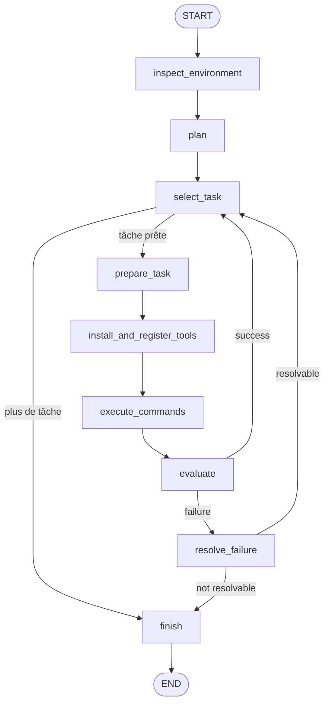

# EV Agent Linux — LangChain + LangGraph

Agent Linux autonome expérimental basé sur **LangChain**, **LangGraph** et **Ollama**.

> ⚠️ **Projet expérimental.** L'agent peut générer du code et exécuter des commandes Linux. Il ne faut pas l'utiliser sur une machine de production ou contenant des données importantes sans sandbox/VM et contrôles supplémentaires.

## 🎯 Objectif du projet

Le but n'est pas seulement de faire un chatbot capable d'exécuter quelques commandes.

L'objectif architectural est de construire une IA capable de **déterminer elle-même les outils dont elle a besoin, générer ces outils, installer les packages nécessaires, les utiliser, vérifier le résultat et apprendre de ses échecs via une boucle de résolution**.

Cette capacité d'auto-outillage est **la direction cible du projet**. Dans la version actuelle, la génération de fichiers Python et l'installation dynamique de packages sont déjà représentées dans le graphe, mais peuvent encore échouer. Cela dépend notamment du modèle Ollama, de son support des sorties structurées, des permissions Linux, de la disponibilité des packages et de la qualité du code généré.

## Pourquoi LangChain + LangGraph ?

- **LangChain** fournit l'intégration avec le LLM Ollama, les messages et les sorties structurées.
- **LangGraph** décrit explicitement le workflow sous forme de machine à états : planification, exécution, vérification et résolution d'erreurs.
- Cette séparation rend l'agent plus facile à faire évoluer vers du streaming, du checkpointing, de la reprise après interruption et du human-in-the-loop. LangGraph est précisément conçu pour les workflows agentiques stateful et long-running. citeturn0search0turn0search3

## Architecture


Le graphe est aussi enregistré directement dans `main.py` dans la constante `MERMAID_ARCHITECTURE`. À chaque lancement, une copie est écrite dans :

```text
AI_Workspace/projet_<id>/.agent/agent_architecture.mmd
```



### Flux détaillé

1. **`inspect_environment`**
   - détecte le répertoire de travail, l'OS, Python et le catalogue local des outils ;
   - prépare le contexte envoyé au modèle.

2. **`plan`**
   - transforme la demande en tâches atomiques ;
   - représente les dépendances entre tâches ;
   - ne génère volontairement pas de commandes shell à cette étape.

3. **`select_task`**
   - choisit une tâche dont toutes les dépendances sont terminées ;
   - détecte les dépendances impossibles ou circulaires.

4. **`prepare_task`**
   - demande au LLM comment réaliser la tâche ;
   - produit les commandes nécessaires ;
   - peut demander la génération d'un nouvel outil Python ;
   - peut déclarer les packages nécessaires.

5. **`install_and_register_tools`**
   - écrit les outils générés dans `.agent/tools/` ;
   - met à jour `.agent/tools.json` ;
   - peut installer les dépendances avec `pip`, `apt`, `npm` ou `cargo`.

6. **`execute_commands`**
   - exécute les commandes dans le workspace du projet ;
   - conserve stdout, stderr, code retour et informations de packages.

7. **`evaluate`**
   - vérifie que la tâche a réellement produit le résultat attendu ;
   - distingue succès et échec.

8. **`resolve_failure`**
   - analyse l'échec ;
   - génère un plan de résolution sous forme de nouvelles tâches ;
   - exécute ensuite ces tâches avant de retenter la tâche originale ;
   - limite la profondeur de résolution pour éviter les boucles infinies.

## Structure du workspace

```text
AI_Workspace/
└── projet_1/
    ├── .agent/
    │   ├── tools.json
    │   ├── agent_architecture.mmd
    │   └── tools/
    │       ├── outil_genere_1.py
    │       └── ...
    └── ... fichiers créés par l'agent ...
```

Chaque IA possède son propre projet : `projet_1`, `projet_2`, etc.

## Auto-outillage : objectif cible

Le point important du projet est le passage d'un agent qui **consomme uniquement des outils codés à l'avance** à un agent qui peut **produire son propre outillage**.

Le cycle visé est :

```text
Demande
   ↓
Planification
   ↓
"Il me manque un outil"
   ↓
Génération du code de l'outil
   ↓
Déclaration des dépendances
   ↓
Installation des packages
   ↓
Enregistrement de l'outil
   ↓
Utilisation
   ↓
Vérification
   ↓
Échec ? ───── oui ───→ Résolution → nouvelle tentative
   │
   non
   ↓
Résultat
```

### Ce qui fonctionne déjà dans l'architecture

- génération d'une spécification d'outil par le LLM ;
- écriture du code généré dans `.agent/tools/` ;
- registre local `.agent/tools.json` ;
- installation expérimentale de dépendances `pip`, `apt`, `npm` et `cargo` ;
- boucle d'évaluation/résolution ;
- tâches dépendantes ;
- limitation de profondeur de résolution.

### Ce qui reste à fiabiliser

La génération de code par un petit modèle local n'est pas toujours correcte. Il faudra notamment ajouter :

- validation/sandbox des outils générés ;
- tests automatiques avant activation d'un outil ;
- isolation Docker/VM ;
- permissions minimales ;
- rollback des installations ;
- meilleur catalogue de capacités ;
- découverte/recherche de packages ;
- exécution directe des fonctions Python générées comme vrais tools LangChain ;
- mémoire persistante/checkpointing ;
- observabilité et traces LangSmith ;
- éventuellement une étape de validation humaine avant une installation sensible.

## Installation

### 1. Créer un environnement virtuel

```bash
python3 -m venv .venv
source .venv/bin/activate
pip install -r requirements.txt
```

### 2. Installer et lancer Ollama

Installer Ollama selon votre OS, puis vérifier qu'il répond :

```bash
ollama serve
```

Dans un autre terminal :

```bash
ollama pull qwen2.5:3b
```

Vous pouvez choisir un autre modèle compatible avec votre installation Ollama :

```bash
export OLLAMA_MODEL=qwen2.5:3b
```

## Utilisation

```bash
python3 main.py --id 1 "Crée un petit projet Python qui lit un fichier CSV et produit un rapport."
```

Ou en mode interactif :

```bash
python3 main.py --id 1
```

Paramètres utiles :

```text
--id          Identifiant de l'IA / workspace
--model       Modèle Ollama
--workspace   Racine des workspaces
--ollama-url  URL de l'API Ollama
--timeout     Timeout d'une commande shell
```

Exemple :

```bash
python3 main.py \
  --id 2 \
  --model qwen2.5:3b \
  --workspace ./AI_Workspace \
  --timeout 300 \
  "Analyse ce dossier et crée un script qui automatise le traitement demandé."
```

## Différence avec l'ancien agent

L'ancien code était organisé autour de méthodes impératives : `plan()`, `execute_task()`, `evaluate()` et `execute_resolution_plan()`. Il gérait déjà une boucle de résolution et un catalogue d'installations. fileciteturn0file0L195-L212 fileciteturn0file0L609-L733

La nouvelle version conserve cette intention mais transforme le workflow en graphe explicite : chaque étape devient un **node LangGraph**, et les transitions succès/échec deviennent des **conditional edges**. Cela permet de faire évoluer progressivement l'agent sans revenir à une grosse fonction récursive.

L'ancien agent envoyait également des appels indépendants à Ollama sans historique. fileciteturn0file0L128-L156 La version LangGraph conserve par défaut une séparation claire entre les appels métier tout en plaçant l'état de l'exécution dans le `StateGraph`. Un checkpointer pourra être ajouté ultérieurement si l'on veut une reprise persistante entre interruptions. LangGraph fournit justement cette primitive de checkpointing. citeturn0search3

## Sécurité

Le projet assume actuellement un agent capable d'exécuter des commandes Linux. **C'est une capacité expérimentale et dangereuse si elle est utilisée sans isolation.**

Pour une version sérieuse :

1. exécuter l'agent dans une VM ou un container dédié ;
2. limiter CPU/RAM/disque ;
3. supprimer les privilèges root autant que possible ;
4. contrôler les installations `apt` ;
5. ajouter une approbation humaine avant les commandes sensibles ;
6. tester le code généré avant de l'enregistrer comme outil actif ;
7. ajouter un mécanisme de rollback.

## Roadmap

### Phase 1 — actuelle

- [x] LangChain
- [x] LangGraph
- [x] Ollama
- [x] planification
- [x] exécution Linux
- [x] évaluation
- [x] résolution récursive transformée en boucle LangGraph
- [x] génération expérimentale d'outils Python
- [x] installation expérimentale de packages
- [x] registre d'outils
- [x] architecture Mermaid enregistrée dans le code

### Phase 2 — fiabilisation

- [ ] vrais `@tool` LangChain dynamiques
- [ ] tests automatiques des outils générés
- [ ] sandbox par outil
- [ ] découverte de packages et documentation
- [ ] rollback
- [ ] meilleure gestion des erreurs de dépendances

### Phase 3 — agent réellement auto-évolutif

- [ ] mémoire persistante des outils efficaces
- [ ] sélection automatique d'un outil existant avant d'en générer un nouveau
- [ ] amélioration automatique d'un outil qui échoue
- [ ] benchmark de ses propres outils
- [ ] versioning des outils
- [ ] score de fiabilité par outil
- [ ] remplacement automatique d'un outil défectueux

### Phase 4 — production

- [ ] LangGraph checkpointing persistant
- [ ] human-in-the-loop
- [ ] observabilité LangSmith
- [ ] sandbox/VM
- [ ] politiques de permissions
- [ ] gestion des secrets
- [ ] tests de sécurité

## Références

- Documentation LangGraph : https://langchain-ai.github.io/langgraph/
- Documentation LangChain : https://python.langchain.com/
- Intégration Ollama LangChain : https://python.langchain.com/docs/integrations/chat/ollama/

LangGraph est particulièrement adapté ici parce qu'il est conçu pour orchestrer des agents stateful et des workflows longs avec possibilité de persistance, reprise et human-in-the-loop. citeturn0search0turn0search4
